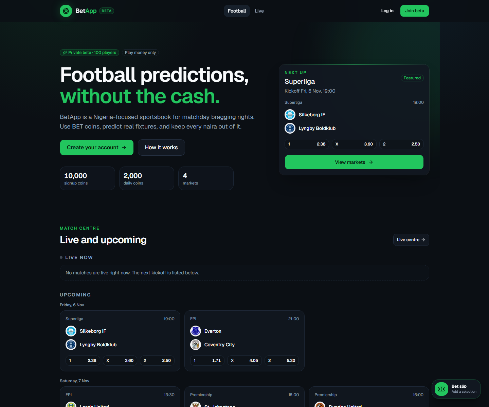
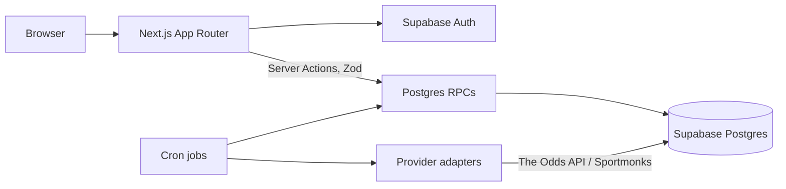

# BetApp

A closed-loop, play-money football prediction game for a Nigeria-focused private beta. Live at **[betapp-staging.vercel.app](https://betapp-staging.vercel.app/)**.

BET coins have no cash value. No purchases, cash-out, prizes, or real-money wagers. 18+.

**Demo login:** `demo@betapp.app` / `BetApp-Demo-2026` — play-money wallet, seeded with 10,000 BET. No email confirmation needed.



## What it does

- **Fixture and odds board** — EPL fixtures and prices normalized from The Odds API or Sportmonks through one provider interface. Four markets: 1X2, O/U 2.5, Both Teams to Score, Double Chance.
- **Bet slip** — singles and accumulators from 2 to 10 legs, one selection per match, payout preview, odds-change review before submission.
- **Atomic placement** — `place_bet` locks the wallet and catalog rows, snapshots odds per leg, and debits once. An idempotency key makes retries safe. Stakes 100–50,000, capped payout 1,000,000 BET.
- **Wallet** — 10,000 signup coins, 2,000 daily claim, full ledger of every credit and debit.
- **Automatic settlement** — legs evaluated from regulation-time results; void and refund recalculations; replaying a settlement is a no-op. Admin settle/void actions require a reason and write an audit record.
- **Admin console** — settlement queue, users, audited balance adjustments, transactions, settings, provider sync status, and audit log.
- **Auth** — email/password with confirmation and reset, edge session refresh, authoritative `requireUser()` / `requireAdmin()` checks in layouts and Server Actions.

## Stack

Next.js 16.4 (App Router, Cache Components, Server Actions) · React 19.3 · TypeScript · Tailwind CSS 4 · shadcn/ui (Base UI) · Supabase Postgres + Auth · Drizzle ORM · Zod · Zustand · Vercel.

## Evidence

| Claim | Where it is verifiable |
|---|---|
| Staging runs the app end to end | [betapp-staging.vercel.app](https://betapp-staging.vercel.app/) |
| Provider sync validated: 10 EPL fixtures, 20 markets, 50 selections, zero odds failures (2026-11-03) | `sync_runs` log; setup detail in [`docs/INTERNAL_README.md`](docs/INTERNAL_README.md) |
| Bet rate limit holds: 11 attempts in one minute → 10 accepted, 11th rejected | Manual SQL verification against the hosted project, documented in the internal README |
| Waitlist limit: 6 submissions → 5 accepted, 6th rejected | Same |
| Beta cap serialized: two concurrent signups cannot exceed the cap | Two-session test; `handle_new_user` takes an advisory lock before counting |
| Physical cleanup job works | One expired rate-limit bucket and one stale unverified account removed in the verified run |
| Lint and typecheck clean | `npm run check` |
| 15 commits · 9 SQL migrations · 17 tables · 14 Postgres functions · 12 RLS policies | Repository |

No automated end-to-end suite is checked in yet. The checks above were manual and, where they touched money, run inside rolled-back SQL transactions. A Playwright suite around placement and settlement is the next change.

## Architecture



Server Actions validate input and call `SECURITY DEFINER` functions; the browser never supplies a user ID. Provider adapters normalize fixtures, odds, and results into Postgres, so the lobby and live views read only the database. Cron routes are protected by a bearer secret.

## Security model

- Row-level security on every user table; catalog tables are public-read.
- The service-role key stays server-side and follows an explicit authorization check; admin RPCs re-check the caller's role inside Postgres.
- `place_bet` and `apply_bet_settlement` are the only writers for bets, legs, and settlements.
- Fixed-window rate limits run in Postgres; IPs are SHA-256 hashed with a salt before storage.
- CSP, HSTS, COOP/CORP, frame denial, MIME sniffing protection, and a strict `noindex` policy.

## Run locally

Requires Node 22+ and a Supabase project.

```bash
npm install
cp .env.example .env.local   # Supabase URL, keys, database URLs
npx supabase db push         # or apply supabase/migrations/*.sql in order
npm run dev
```

Full setup, provider configuration, cron jobs, and staging runbook: [`docs/INTERNAL_README.md`](docs/INTERNAL_README.md).

## Design decisions

- **Coins are integer `bigint`.** No floats anywhere in the wallet. Odds are decimal; payouts round once, at settlement.
- **Odds are snapshotted per leg.** Settlement pays the price the player accepted, not the live price.
- **Stale odds fail closed.** `place_bet` rejects a market older than 900 seconds, so one missed sync does not stop betting, but a provider outage does.
- **Settlement is idempotent.** A repeated call cannot credit a wallet twice.
- **Cron config is split.** `vercel.json` holds the Pro schedule; `vercel.staging.json` holds an empty schedule for Hobby, with a deploy wrapper that swaps them safely.

## Roadmap

- Playwright end-to-end coverage for bet placement and settlement.
- Pro cron schedule for automatic sync and settlement on staging.
- Sentry and PostHog credentials, with alert delivery verified.
- Mobile viewport pass.
- Legal review before any public launch.

## Credits

Club crests are the property of their respective clubs, sourced from [FootyLogos.com](https://www.footylogos.com/) and credited on `/legal#credits`.
